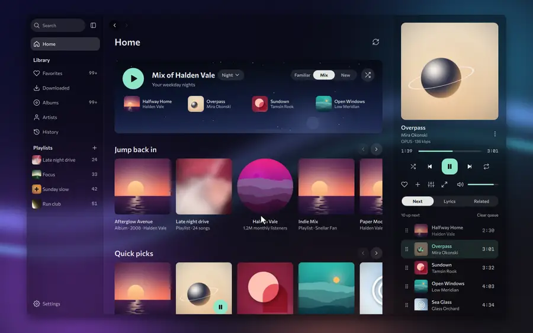

<h1 align="center">Snellar</h1>

<p align="center">A music player for Linux that plays from YouTube Music. Written in Rust, with a Qt Quick window.</p>

<p align="center">
  
</p>

<p align="center"><sub>Recorded in real time. Covers and names are made up for the demo.</sub></p>

## Install

```bash
curl -fsSL https://raw.githubusercontent.com/perunavich/snellar/main/tools/install.sh | bash
```

The script downloads the latest release, checks its checksum and installs it in your home folder: the app in `~/.local/opt/snellar`, a `snellar` command in `~/.local/bin` and a menu entry. It needs no root and changes nothing outside your home.

You need x86_64 Linux with glibc 2.35 or newer. mpv ships inside the AppImage. yt-dlp, which Snellar uses for downloads and when a stream can't be opened directly, is fetched by the installer unless you already have it.

An installed Snellar updates itself: at most once a day it fetches the latest release in the background, checks that it is signed with the project's key, and starts it the next time you open the app. You can turn this off in Settings.

To remove the app and keep your library:

```bash
curl -fsSL https://raw.githubusercontent.com/perunavich/snellar/main/tools/install.sh | bash -s -- uninstall
```

Add `--delete-library` after `uninstall` to delete the library and the cache as well.

## What it does

- Searches YouTube Music and plays songs, albums, artists and playlists. There is no account and no sign-in.
- Likes, playlists with folders, saved albums and followed artists are kept in a local library on your computer.
- Wave, radio and the Home shelves are put together on your computer from your likes, playlists, plays and skips. To find related artists, Snellar asks Deezer, MusicBrainz and ListenBrainz about artists by name or MusicBrainz id, and Last.fm if you add your own key. They get artist names, not your history.
- Imports playlists from a Spotify, Deezer, Apple Music, Yandex Music or SoundCloud link, or from a CSV file made by Exportify or TuneMyMusic. Each song is looked up on YouTube Music.
- Lyrics from lrclib, NetEase, Kugou and YouTube Music, synced to the song when they have timings.
- A 10-band equalizer with bass, reverb and speed, and loudness levelling between tracks.
- Downloads songs to a Snellar folder in your Music folder or one you choose, or keeps whole playlists and albums downloaded. A downloaded song plays from the file without the network.
- On Hyprland, SwayFX and GNOME with blur, the window is see-through and the compositor blurs what is behind it. Elsewhere it shows a blurred copy of the cover. You can also pick a solid background.
- Works with the rest of the desktop: MPRIS media keys and widgets, a tray icon if you want the music to keep playing with the window closed, and the playing song in your Discord status if you turn it on.
- Keyboard control for playback, search and song lists. `Ctrl+/` or `F1` shows every shortcut.
- Interface in English, Ukrainian and Russian.

## For scripts and AI agents

While Snellar runs, it can be controlled from outside the window, through the same methods the window uses:

- `snellar mcp` is an MCP server, so an AI agent can search, play, queue, like and read lyrics.
- `snellar ctl <method> '<json>'` calls any method from the command line.
- An HTTP and JSON API on the Unix socket `$XDG_RUNTIME_DIR/snellar.sock`, with an event stream. Only your user can reach it; there is no network port.

How to connect, with examples: [docs/agents.md](docs/agents.md). Every method, setting and error code: [docs/api.md](docs/api.md). For LLMs: [llms.txt](llms.txt).

## What it connects to

YouTube for search, streams and covers; lrclib, NetEase and Kugou for lyrics; Deezer, MusicBrainz and ListenBrainz for recommendations, and Last.fm only with your own key; the service of a playlist link you import; GitHub for its own updates and for yt-dlp. There is no telemetry. A proxy can be set in Settings, and yt-dlp uses it too.

## Status

Beta. Tested most on Debian 13 with Hyprland. YouTube Music is the only source for now.

If something breaks, press `Ctrl+Shift+B`. Snellar saves a report with a screenshot, the last five minutes of its log and the player state, and offers to show it as a zip file. Nothing is sent: look through the file and attach it to an issue if you want to.

## Contributing

How to build Snellar from source, run the checks and match the code style: [CONTRIBUTING.md](CONTRIBUTING.md).

## License

[GPL-3.0-or-later](LICENSE)
