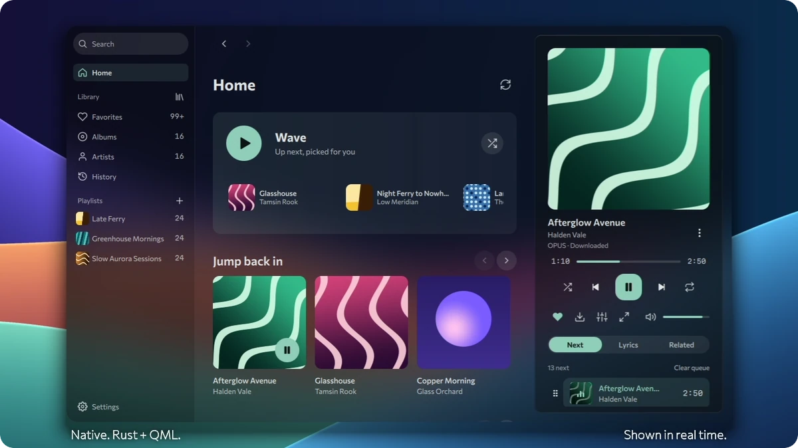

<h1 align="center">Snellar</h1>

<p align="center">A fast, native music player for Linux. Written in Rust and QML.</p>

<p align="center">
  
</p>

<p align="center"><sub>Recorded in real time. Covers and names are made up for the demo.</sub></p>

## Install

```bash
curl -fsSL https://raw.githubusercontent.com/perunavich/snellar/main/tools/install.sh | bash
```

The script downloads the latest release into your home folder and adds a menu entry. It needs no root and changes nothing outside your home. Run it with `uninstall` to remove the app; your library stays unless you ask otherwise.

Everything needed for playback ships inside the AppImage.

## What it does

- **Recommendations.** Wave and radio learn from your likes, playlists, listens and skips, on your own computer.
- **Glass that fits your desktop.** Real blur where the compositor offers it, a blurred cover everywhere else.
- **Your music comes with you.** Import playlists by link from Spotify, Deezer, Apple Music, Yandex Music and SoundCloud, or from a CSV file.
- **Lyrics, equalizer, even loudness, downloads.**
- **A good Linux citizen.** MPRIS, tray, Discord status, keyboard control.
- **Ready for scripts and AI.** A local API, `snellar ctl` on the command line and a built-in MCP server.

The catalog comes from YouTube Music today. Sources sit behind one interface, so more can follow.

## Status

Beta. Tested most on Debian 13 with Hyprland. Found a bug? Press `Ctrl+Shift+B`: Snellar packs a report that you can look through and send.

## License

[GPL-3.0-or-later](LICENSE)
